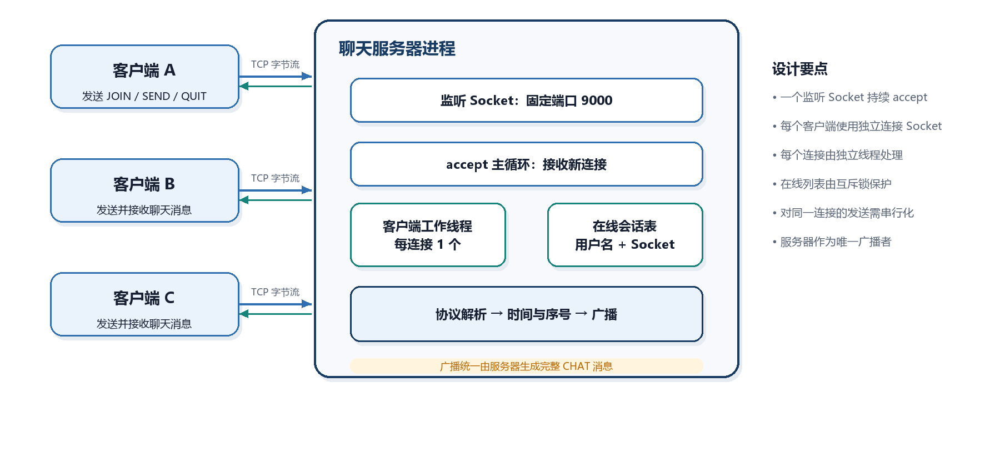

# 计算机网络实验报告
## lab1：Socket编程
刘宇泽  2411334

### 一、实验要求
- 使用流式Socket，设计一个聊天协议，要求聊天信息带时间。请完整说明交互消息语法、语义、时序等具体消息处理方式
- 设计聊天程序，给出模块划分说明、模块功能和流程图
- 利用C或C++语言，使用基本Socket函数进行程序编写，不允许使用封装后的Socket类或架构。程序界面可用命令行方式，但需给出使用方法
- 应用程序应支持英文和中文聊天
- 采用多线程，支持多人聊天
- 编写的程序应结构清晰，具有较好的可读性
- 观察是否有数据包的丢失
- 撰写实验报告，并将实验报告和源码提交至网站

### 二、GitHub仓库
>本实验报告以及代码已推送至该仓库https://github.com/liuyuze-121/NKU-ComputerNetwork-Lab.git

### 三、聊天协议设计
#### 1. 系统结构
系统采用集中式Client/Server结构。所有Client连接同一Server，聊天message由Server中转，Client之间不直接建立连接。



<p align="center"><strong>图 1　聊天系统总体结构</strong></p>

Server包含一个持续执行的 `accept` 主循环。每接受一个新连接，Server创建一个session对象，并启动一个worker thread负责该连接的frame接收和协议处理。online session table保存已经登录的username及其连接 Socket。Server是聊天broadcast的唯一生成者。

Client结构可以概括为：

```text
连接Server
    |
发送 JOIN 并等待 JOIN_OK
    |
同时进行“命令行输入发送”和“网络message接收”
    |
发送 QUIT 或发生连接异常
    |
close Socket 并释放资源
```
#### 2. 协议分层

本协议分为传输分帧层和聊天语义层。

##### 2.1 传输分帧层
分帧层（framing layer）负责从连续 TCP 字节流中恢复一条完整 protocol message。其 frame 格式为：

```text
[4-byte unsigned Length][Length-byte UTF-8 Payload]
```


<p align="center"><strong>图 2　应用层消息帧格式</strong></p>

约束如下：

| 项目 | 规定 |
|---|---|
| Length field 大小 | 4 字节 |
| Length field 类型 | 无符号 32 位整数 |
| Length field 字节序 | network byte order，发送端使用 `htonl`，接收端使用 `ntohl` |
| payload 长度范围 | 1 至 4096 字节 |
| payload 编码 | UTF-8 |
| payload 含义 | 一条完整的 application-layer message |

##### 2.2  发送与接收原则

发送端（sender）首先计算 payload 的 UTF-8 字节数，再发送 4-byte Length field，最后发送完整 payload。由于 TCP 的 `send` 可能只发送部分字节，发送过程必须循环直到全部 bytes 发送完成。

接收端（receiver）首先循环读取完整的 4-byte Length field，转换 byte order 并检查长度范围，然后循环读取恰好 `Length` 个 payload bytes。只有 payload 全部到达后，才能把该 frame 交给协议解析器。

该设计保证：

- 一次 `send` 被拆成多次 `recv` 时可以恢复完整消息。
- 多次 `send` 被合并到一次 `recv` 时可以逐帧解析。
- 接收端不会把消息长度误认为字符数。
- 中英文字符串不会因为 UTF-8 多字节编码而发生截断。
- 非法或超大长度不会直接导致无上限的内存分配。

#### 3. 消息语法
##### 3.1 词法约定

- message type 区分大小写，统一使用大写 ASCII 字符串。
- field 之间使用竖线 `|` 分隔。
- payload 位于最后一个 field 时，可以包含竖线。
- 每条正文不包含换行符。
- username 限定为 1 至 20 bytes，只允许英文字母、数字和下划线。
- 聊天正文限定为 1 至 3000 字节，必须为合法 UTF-8。
- 时间格式固定为 `YYYY-MM-DD HH:mm:ss`。
- sequence number 为从 1 开始递增的十进制无符号整数。

##### 3.2 请求消息
| message type | 语法 | 说明 |
|---|---|---|
| `JOIN` | `JOIN|username` | 请求以指定用户名加入聊天室 |
| `SEND` | `SEND|content` | 请求发送一条聊天正文 |
| `QUIT` | `QUIT` | 请求正常退出聊天室 |

#####  3.3 响应与广播消息

| 消息类型 | 方向 | 语法 |
|---|---|---|
| `JOIN_OK` | 服务器到单个客户端 | `JOIN_OK|username` |
| `CHAT` | 服务器到全部客户端 | `CHAT|sequence|timestamp|username|content` |
| `SYSTEM` | 服务器到全部客户端 | `SYSTEM|timestamp|content` |
| `ERROR` | 服务器到单个客户端 | `ERROR|code|message` |

##### 3.4 字段定义

| field | 所属消息 | 定义 |
|---|---|---|
| `username` | `JOIN`、`JOIN_OK`、`CHAT` | 用户唯一名称 |
| `sequence` | `CHAT` | Server 分配的 global sequence number |
| `timestamp` | `CHAT`、`SYSTEM` | Server 生成的 timestamp |
| `content` | `SEND`、`CHAT`、`SYSTEM` | UTF-8 文本内容 |
| `code` | `ERROR` | 十进制错误编号 |
| `message` | `ERROR` | 面向用户的可读错误说明 |

##### 3.5 字段解析规则

对于 `SEND`，Client 的 content 位于第一个竖线之后，因此 Server 只分割第一个 `|`，剩余全部内容均作为聊天正文。

例如：

```text
SEND|TCP|UDP 有什么区别？
```

解析结果：

```text
content = TCP|UDP 有什么区别？
```

对于 `CHAT`，Server 和 Client 只分割前四个 `|`。第五个 field 及其后的全部内容作为一个完整的 `content`：

```text
CHAT|12|2026-10-22 17:20:31|alice|你好，TCP|UDP 有什么区别？
```

解析结果：

| 字段 | 值 |
|---|---|
| 类型 | `CHAT` |
| 序号 | `12` |
| 时间 | `2026-10-22 17:20:31` |
| 用户名 | `alice` |
| 正文 | `你好，TCP|UDP 有什么区别？` |


#### 4. 消息语义
##### 4.1 登录消息 `JOIN`

Client 在 TCP connection 建立后发送的第一条 message 必须为 `JOIN`。Server 检查 username format 和 uniqueness。

处理成功时，Server：

1. 返回 `JOIN_OK|username`。
2. 将 session 标记为 `AUTHENTICATED`。
3. 将 username 和 connection Socket 加入 online session table。
4. 向所有已登录 Client broadcast `SYSTEM` join notification。

处理失败时，Server 返回对应的 `ERROR` message，随后 close 该 connection。

##### 4.2 聊天请求 `SEND`

只有 `AUTHENTICATED` Client 可以发送 `SEND`。Client 不能自行填写 sender、timestamp 或 sequence number。

Server 收到合法 `SEND` 后执行：

1. 检查聊天正文是否为空、是否超过长度限制、是否为合法 UTF-8。
2. 在 broadcast critical section 中分配下一个 sequence number。
3. 生成 Server-side timestamp。
4. 使用 session 中的真实 username 组装 `CHAT` message。
5. 将相同的 `CHAT` message broadcast 给全部已登录 Client。

示例：

```text
客户端发送：
SEND|大家好

服务器广播：
CHAT|1|2026-10-22 17:20:31|alice|大家好
```

##### 4.3 登录响应 `JOIN_OK`

`JOIN_OK` 表示 Client authentication 成功。Client 收到该 message 后，才允许进入聊天输入阶段。该 message 之后，Server 可能立即发送 `SYSTEM` 或 `CHAT` broadcast。

##### 4.4 聊天广播 `CHAT`

`CHAT` 是 Server 生成的 authoritative chat message。同一次 broadcast 中，所有 Client 必须收到完全相同的 sequence number、timestamp、username 和 content。

客户端展示格式建议为：

```text
[2026-10-22 17:20:31] alice (#1): 大家好
```

##### 4.5 系统消息 `SYSTEM`

`SYSTEM` 用于 broadcast 用户加入、离开等聊天室状态变化。该 message 由 Server 生成并带 timestamp，Client 不能直接发送。

##### 4.6 退出消息 `QUIT`

`QUIT` 表示 Client 主动退出聊天室。Server 收到后删除该 session，向其他 Client broadcast leave notification，并 close connection Socket。

如果 Server 接收到 connection closed 或 Socket I/O error，也执行相同的 session cleanup logic，从而处理进程崩溃、网络中断等异常退出。

#### 5. 协议状态机
每个客户端连接在服务器端具有三个逻辑状态：

1. `CONNECTED`：TCP 已连接，但尚未完成登录。
2. `AUTHENTICATED`：已经收到合法 `JOIN`，允许聊天。
3. `CLOSED`：连接结束，相关会话和 Socket 已释放。


<p align="center"><strong>图 3　客户端连接状态机</strong></p>

| 当前状态 | 合法输入 | 处理结果 |
|---|---|---|
| `CONNECTED` | 合法 `JOIN` | 返回 `JOIN_OK`，进入 `AUTHENTICATED` |
| `CONNECTED` | 其他消息 | 返回错误并进入 `CLOSED` |
| `AUTHENTICATED` | `SEND` | 校验并 broadcast `CHAT`，state 不变 |
| `AUTHENTICATED` | `QUIT` | 清理 session 并进入 `CLOSED` |
| `AUTHENTICATED` | 重复 `JOIN` | 返回 `ERROR 4`，状态不变 |
| `AUTHENTICATED` | 未知类型 | 返回 `ERROR 6`，状态不变 |
| `AUTHENTICATED` | connection lost 或 I/O error | 清理 session 并进入 `CLOSED` |

#### 6. 交互时序


下图展示两个客户端的登录、系统通知、聊天广播和退出过程。


<p align="center"><strong>图 4　登录、聊天与退出交互时序</strong></p>

#### 7. 服务器处理流程
Server 接受连接后，为每个 Client 创建独立 worker thread。worker thread 持续执行“接收完整 frame、解析消息、执行动作”的循环。


<p align="center"><strong>图 5　服务器消息处理流程</strong></p>

##### 7.1 登录前处理

worker thread 读取第一条完整 message，并检查其 type 是否为 `JOIN`。如果首条 message 不是 `JOIN`，Server 返回 `ERROR 3` 并 close connection。username format error 返回 `ERROR 1`，username duplicate 返回 `ERROR 2`。

##### 7.2 登录后处理

`AUTHENTICATED` session 只接受以下行为：

- `SEND`：校验 content 并 broadcast `CHAT`。
- `QUIT`：清理 session 并关闭 connection。
- 其他 type：返回 non-fatal format error，继续等待下一条 message。

##### 7.3 广播一致性

为避免多个 worker thread 同时分配 sequence number 或向同一个 Socket 交错写入，Server 必须保证：

1. sequence number 分配和 broadcast 顺序位于同一 mutex 保护的临界区。
2. 对同一个连接 Socket 的完整 frame 写入需要串行化。
3. 不在持有 online session table mutex 时执行可能阻塞的网络 I/O。

这样可以避免不同线程写入半个帧，避免两个聊天消息序号与其广播顺序不一致。

#### 8. 错误处理

| 错误码 | 名称 | 触发条件 | 处理策略 |
|---:|---|---|---|
| 1 | 用户名格式错误 | 用户名不符合字段约束 | 返回错误并关闭连接 |
| 2 | 用户名重复 | 在线列表中已存在同名用户 | 返回错误并关闭连接 |
| 3 | 尚未登录 | 首条消息不是 `JOIN` | 返回错误并关闭连接 |
| 4 | 字段格式错误 | 字段数量、消息边界或消息类型正确但参数不合法 | 返回错误并保持连接 |
| 5 | 聊天正文非法 | 为空、超过 3000 字节或不是合法 UTF-8 | 返回错误并保持连接 |
| 6 | 未知消息类型 | 类型不属于协议定义 | 返回错误并保持连接 |

帧级异常包括：

- 长度字段为 0。
- 长度字段大于 4096。
- 正文未完整到达且连接已经关闭。
- `recv` 返回 Socket 错误。
- 对端正常关闭连接。

帧级异常不能通过应用层 `ERROR` 消息继续恢复，服务器应释放该连接资源。对于已登录用户，还需要广播离开系统消息。

#### 9. 并发与发送完整性

多人聊天使用多线程实现。服务器主线程负责 `accept`，每个客户端连接由独立工作线程读取消息。客户端至少使用一个网络接收线程处理服务器广播，同时由命令行输入循环发送消息。

发送侧遵循以下规则：

1. 一个完整帧包含长度首部和正文，两次发送之间不能被其他线程插入半个帧。
2. 对同一个客户端的 `send` 操作由该会话的发送锁串行化。
3. 广播时先取得在线会话快照，再逐个连接发送。
4. 接收端始终通过 `receiveExactly` 读取固定字节数，而不是假定一次 `recv` 等于一帧。

#### 10. 丢包观察方案

服务器为每条 `CHAT` 消息生成从 1 开始递增的全局序号。所有客户端均显示该序号，用于观察应用层消息完整性。

##### 10.1 测试步骤

1. 启动服务器、发送客户端和观察客户端。
2. 发送客户端连续发送 200 条测试消息。
3. 观察客户端记录收到的消息序号。
4. 检查序号是否连续、是否存在重复以及消息数量是否与发送数量一致。
5. 使用 Wireshark 设置显示过滤器 `tcp.port == 9000`，观察 TCP 重传、确认和连接关闭过程。

##### 10.2 判定原则

TCP 会对底层丢失的报文段进行重传，正常情况下应用层应按序收到完整字节。如果应用层出现序号缺失或消息被截断，应依次检查：

- 长度首部是否被完整接收。
- 正文是否按指定长度完整接收。
- 是否错误地把一次 `recv` 当作一条完整消息。
- 多线程广播是否造成同一连接上的帧交错。
- 客户端断开后，服务器是否仍保留失效会话。

---

### 四、程序设计

#### 4.1 模块划分与职责边界

主程序按照“网络基础、服务端业务、客户端交互”三个层次组织。`common` 提供可复用的网络收发和协议处理能力，`server` 负责多 Client 调度与广播，`client` 负责命令行输入和结果显示。

```text
lab1/code/src/
├── common/
│   ├── net_common.h
│   ├── net_common.cpp
│   ├── protocol.h
│   └── protocol.cpp
├── server/
│   ├── chat_server.h
│   ├── chat_server.cpp
│   └── server_main.cpp
└── client/
    ├── chat_client.h
    ├── chat_client.cpp
    └── client_main.cpp
```

| 模块 | 组成文件 | 模块职责 |
|---|---|---|
| common | `net_common.h/.cpp`、`protocol.h/.cpp` | 初始化 Winsock，完成完整字节收发、frame 编解码、协议解析、字段校验、timestamp 生成和线程安全日志 |
| server | `server_main.cpp`、`chat_server.h/.cpp` | 监听连接，创建 worker thread，管理 session，处理登录与聊天请求，分配 sequence 并执行 broadcast |
| client | `client_main.cpp`、`chat_client.h/.cpp` | 连接 Server，完成登录，读取命令行输入，并行接收和显示 Server 消息 |


<p align="center"><strong>图 6　主程序模块划分与依赖关系</strong></p>

模块的输入输出边界如下：

| 模块 | 主要输入 | 主要输出 |
|---|---|---|
| common | Socket 句柄、待发送 payload、待解析 frame | 收发状态、完整 message、解析结果 |
| server | Client connection、`JOIN`、`SEND`、`QUIT` | `JOIN_OK`、`CHAT`、`SYSTEM`、`ERROR` |
| client | 用户命令行输入、Server broadcast frame | `JOIN`、`SEND`、`QUIT` 请求，终端显示 |

这种划分有三个作用：第一，把拆包、粘包、UTF-8 校验等通用逻辑集中到 `common`；第二，让 Server 只关注 session、sequence 和 broadcast；第三，让 Client 只关注输入与显示。`ClientSession`、`ChatServer` 和 `ClientContext` 仅保存状态及同步对象，Socket 的创建、连接、监听和收发仍直接通过基础 Socket 函数完成。

#### 4.2 common 模块

##### 4.2.1 `net_common.h` 与 `net_common.cpp`

该模块是 Server 与 Client 共用的网络基础层，负责 Winsock 生命周期和 TCP byte stream 的完整收发。

| 函数 | 模块功能 |
|---|---|
| `initializeNetwork` | 调用 `WSAStartup`，初始化 Windows Socket 环境 |
| `cleanupNetwork` | 调用 `WSACleanup`，释放 Socket 环境资源 |
| `socketErrorMessage` | 将 Socket 错误码转换为统一日志文字 |
| `sendAll` | 循环调用 `send`，直到指定字节数全部写完 |
| `receiveExactly` | 循环调用 `recv`，直到指定字节数全部读完，并区分成功、正常关闭和异常 |
| `sendFrame` | 将 payload 长度转换为 network byte order，再发送 Length field 和 payload |
| `receiveFrame` | 接收完整 Length field，转换 byte order，校验范围后读取完整 payload |
| `configureConsoleUtf8` | 将 Windows 终端配置为 UTF-8 |
| `logLine` | 使用 mutex 保护日志输出，避免多个 worker thread 的日志交错 |

该模块的关键是 `sendAll` 和 `receiveExactly`。TCP 的 `send` 可能只写出部分字节，`recv` 也可能只返回部分数据，因此不能假设一次函数调用就完成一个 frame。`sendFrame` 和 `receiveFrame` 在完整收发的基础上加入 4-byte Length field，使上层业务只处理完整 message，不需要重复解决拆包和粘包问题。

##### 4.2.2 `protocol.h` 与 `protocol.cpp`

该模块只处理应用层 message，不直接操作 Socket。

| 函数类别 | 函数 | 模块功能 |
|---|---|---|
| 通用解析 | `splitMessage` | 将 `type|arg1|arg2` 拆为类型和参数，限制最大字段数，使 `content` 可以包含 `|` |
| 通用构造 | `buildMessage` | 使用竖线将多个字段组装为 payload |
| 输入校验 | `isValidUtf8` | 检查 UTF-8 字节序列是否合法 |
| 输入校验 | `isValidUsername` | 检查 username 的长度、ASCII 范围和下划线规则 |
| 输入校验 | `isValidChatContent` | 检查 content 是否为空、超长、含换行或编码非法 |
| 时间生成 | `currentTimestamp` | 生成 Server 当前时间 `YYYY-MM-DD HH:mm:ss` |
| 消息构造 | `makeJoinOk` | 构造 `JOIN_OK|username` |
| 消息构造 | `makeChatBroadcast` | 构造带 sequence、timestamp、username、content 的 `CHAT` |
| 消息构造 | `makeSystemMessage` | 构造带 timestamp 的 `SYSTEM` |
| 消息构造 | `makeErrorMessage` | 构造 `ERROR|code|message` |
| 请求解析 | `parseJoinRequest` | 校验并解析登录请求 |
| 请求解析 | `parseSendRequest` | 校验并解析聊天发送请求 |
| 响应解析 | `parseJoinOk` | 解析登录成功响应 |
| 响应解析 | `parseChatBroadcast` | 解析聊天广播 |
| 响应解析 | `parseSystemMessage` | 解析系统通知 |
| 响应解析 | `parseErrorMessage` | 解析错误码和错误说明 |

内部辅助函数 `joinFields` 统一完成字段拼接，`parseUnsignedInteger` 严格解析 sequence 和 error code。该模块将 message format 与网络传输分离，使 Server 和 Client 对相同字段采用一致的校验和解析规则。

#### 4.3 server 模块

##### 4.3.1 `server_main.cpp`

`main` 是 Server 的程序入口，负责配置 UTF-8 终端、读取可选 port、检查 port 范围，并调用 `runChatServer`。默认 port 为 9000。

##### 4.3.2 `chat_server.h` 与 `chat_server.cpp`

Server 模块维护两种核心状态结构：

| 结构 | 作用 |
|---|---|
| `ClientSession` | 保存 Client 的 socket、username、登录状态、active 标志和 send mutex |
| `ChatServer` | 保存 listening Socket、online session table、broadcast mutex、next sequence 和运行状态 |

| 函数 | 模块功能 |
|---|---|
| `runChatServer` | 初始化 Winsock，完成 `socket -> bind -> listen`，持续执行 `accept`，为每个 Client 创建 worker thread |
| `handleClient` | 处理单个 Client 的首次登录、登录后 message 循环、异常退出和资源清理 |
| `sendPayload` | 在 session 的 send mutex 保护下发送完整 frame，并在失败时使连接失效 |
| `loggedClientSnapshot` | 在 clients mutex 保护下复制已登录 Client 列表，避免持锁执行网络发送 |
| `broadcast` | 遍历 Client 快照，向全部已登录 Client 发送同一 payload |
| `reserveUsername` | 在返回 `JOIN_OK` 前检查并保留唯一 username |
| `markClientLoggedIn` | 将完成登录握手的 session 标记为已登录 |
| `removeClient` | 从 online session table 删除 session，并关闭对应 Socket |
| `announceSystem` | 生成并 broadcast 带 timestamp 的 `SYSTEM` 消息 |
| `sendProtocolError` | 向指定 Client 返回 `ERROR` 消息 |
| `performJoin` | 完成 username 保留、`JOIN_OK`、登录状态更新和加入广播 |

Server 的运行职责可以概括为四步：

1. 主线程持续执行 `accept`，只负责接收新连接。
2. 每个 connection 对应一个 `ClientSession`，并启动独立 worker thread 执行 `handleClient`。
3. 登录前只接受 `JOIN`；登录后根据 message type 分派 `SEND` 和 `QUIT`。
4. Client 正常退出、EOF 或 I/O error 时统一进入 `removeClient`，保证 session 和 Socket 被释放。

##### 4.3.3 并发与广播一致性

Server 使用三层同步机制：

| 同步对象 | 保护内容 | 设计目的 |
|---|---|---|
| `clientsMutex` | online session table、登录状态、username 保留 | 防止并发登录和断线清理破坏共享列表 |
| `broadcastMutex` | sequence 分配、`CHAT` 构造、broadcast 顺序 | 保证序号顺序与广播顺序一致 |
| `sendMutex` | 单个 connection Socket 的完整 frame 写入 | 防止多个线程交错写入同一 frame |

广播前先取得 Client 快照，再释放 `clientsMutex` 执行网络 I/O，避免慢速 Client 长时间阻塞整个 session table。该设计同时保证聊天 message 的 sender、timestamp 和 sequence 由 Server 统一生成。

#### 4.4 client 模块

##### 4.4.1 `client_main.cpp`

`main` 负责配置 UTF-8 终端、读取可选的 Server IP 和 port，并调用 `runChatClient`。默认连接 `127.0.0.1:9000`。

##### 4.4.2 `chat_client.h` 与 `chat_client.cpp`

Client 使用 `ClientContext` 保存 connection 状态：

| 字段 | 作用 |
|---|---|
| `socketValue` | 与 Server 通信的 Socket |
| `running` | 控制 input loop 与 receiver thread 的生命周期 |
| `sendMutex` | 保证完整 frame 的发送操作串行化 |
| `outputMutex` | 避免提示符与远程消息交错输出 |

| 函数 | 模块功能 |
|---|---|
| `runChatClient` | 初始化网络、连接 Server、登录、启动 receiver thread、运行 input loop 并释放资源 |
| `connectToServer` | 创建 TCP Socket，调用 `connect` 连接指定 IP 和 port |
| `performLogin` | 读取 username，发送 `JOIN`，同步等待 `JOIN_OK` 或 `ERROR` |
| `runInputLoop` | 处理普通聊天、`/help`、`/quit` 和 `/stress` 命令 |
| `receiveMessages` | 持续接收 frame，按 `CHAT`、`SYSTEM` 和 `ERROR` 分类显示 |
| `sendWithLock` | 在 send mutex 保护下发送完整 frame |
| `printOutput` | 使用 output mutex 保护终端输出 |
| `printUsage` | 显示命令行使用说明 |
| `sendStressMessages` | 连续发送测试 message，用于观察 sequence 是否连续 |

登录阶段由主线程同步等待 `JOIN_OK`。登录完成后，主线程运行 `runInputLoop`，另一个 receiver thread 运行 `receiveMessages`，从而支持边输入边接收广播。Client 只发送 `JOIN`、`SEND`、`QUIT` 请求，不生成 username、timestamp 或 sequence，显示内容以 Server 返回的权威 message 为准。

#### 4.5 模块调用流程

Client 发送聊天内容时，模块调用顺序如下：

```text
Client 输入
    -> buildMessage 生成 SEND message
    -> sendWithLock / sendFrame 发送完整 frame
    -> TCP byte stream
    -> Server receiveFrame 恢复完整 message
    -> parseSendRequest 校验 content
    -> 分配 sequence 并生成 timestamp
    -> makeChatBroadcast 生成 CHAT message
    -> broadcast 遍历 online Clients
    -> sendPayload / sendFrame 发送完整 frame
    -> Client receiveMessages
    -> parseChatBroadcast 解析 message
    -> printOutput 显示结果
```


<p align="center"><strong>图 7　主程序模块调用流程</strong></p>

从模块边界看，Client 和 Server 共享 `common` 的 frame 与 protocol 能力，但业务职责不同：

1. Client 负责将用户输入转换为 `SEND` 请求，并显示 Server 返回的 message。
2. Server 负责身份校验、session 管理、timestamp、sequence 和 broadcast。
3. common 保证两端收到的始终是一条完整 message，并为上层提供统一的协议解析接口。

因此，程序在保留基础 Socket 函数调用方式的同时，实现了网络 I/O、协议处理和聊天业务的分层，结构清晰且便于维护。


---

### 五、结果演示

#### 1. Client 未启动 Server 时的连接结果

未启动 Server 时运行 Client，`connect` 连接 `127.0.0.1:9000`，返回错误码 `10061`。Client 输出连接失败信息后释放资源并退出。


<p align="center"><strong>图 8　Client 未启动 Server 时的连接失败</strong></p>

该结果表明：目标端口没有 Server 监听时，TCP 连接会被拒绝，Client 能正确识别并处理连接失败。

#### 2. Server 启动与监听

启动 Server 并指定端口 `9000`，终端显示监听成功。随后 Server 进入 `accept` 循环，等待 Client 建立连接。


<p align="center"><strong>图 9　Server 启动与监听</strong></p>

#### 3. Client 连接与登录

Client 连接 `127.0.0.1:9000`，输入用户名 `liuyuze` 后收到 `JOIN_OK`。Server 和 Client 终端同时显示该用户加入聊天室的系统消息。


<p align="center"><strong>图 10　Client 连接与登录</strong></p>

该结果表明登录握手和带时间的 `SYSTEM` 广播均正常。

#### 4. 多 Client 中英文聊天

`liuyuze` 和 `liuyuzee` 两个 Client 依次发送中文和英文消息，Server 与两个 Client 均显示相同的序号、时间、用户名和内容。


<p align="center"><strong>图 11　多 Client 中英文聊天</strong></p>

该结果表明多 Client broadcast 与 UTF-8 中英文显示均正常。

#### 5. 重复用户名校验

第三个 Client 使用已存在的用户名 `liuyuze` 登录，Server 返回 `ERROR 2`，Client 显示“用户名已被占用”并退出。


<p align="center"><strong>图 12　重复用户名校验</strong></p>

该结果表明 Server 的 username uniqueness check 和登录失败清理均正常。

#### 6. 连续消息与丢包观察

`liuyuze` 连续发送 20 条测试消息，Server 和两个 Client 均显示全局序号 `#3` 至 `#22`，测试消息 `1` 至 `20` 全部到达。


<p align="center"><strong>图 13　连续消息与丢包观察</strong></p>

该结果表明当前 TCP 连接下未观察到应用层消息丢失、重复或乱序。

#### 7. 正常退出

`liuyuze` 输入 `/quit` 后 Client 退出，Server 删除对应 session 并记录离开；`liuyuzee` 收到带时间的离开通知。


<p align="center"><strong>图 14　正常退出</strong></p>

该结果表明 `QUIT`、资源清理和离开消息 broadcast 均正常。

#### 8. 异常断线清理

Client `charlie` 登录后未发送 `QUIT`，直接关闭终端窗口。Server 检测到接收失败并删除对应 session，`liuyuzee` 随后收到带时间的离开通知。


<p align="center"><strong>图 15(a)　charlie 登录</strong></p>


<p align="center"><strong>图 15(b)　关闭窗口后的异常清理</strong></p>

该结果表明非正常断线也会进入统一的 session cleanup 和 leave broadcast 流程。

### 六、总结与收获

本次实验完成了基于 TCP 流式 Socket 的多人在线聊天程序，实现了自定义分帧与消息协议、服务器时间、全局消息序号、中英文聊天、多线程广播、用户名校验、正常退出和异常断线清理。Server 负责统一生成广播消息，Client 通过输入线程和接收线程实现边发送边接收。

通过实验，我重点理解了 TCP 字节流不保留消息边界、`send` 和 `recv` 可能只处理部分数据，以及互斥锁在会话管理和广播中的必要性。连续消息测试中消息序号保持连续，未观察到应用层消息丢失，也加深了对网络协议设计、并发控制和 Socket 编程流程的理解。
